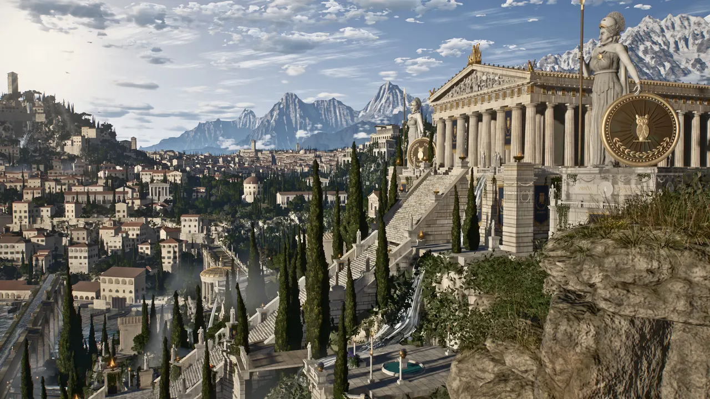

# Athenaion · Architectural AI Lab

A nine-view architectural gallery with an optional procedural Three.js world. Russian and English, touch-friendly scene selection, Light / Balanced / High quality and recovery when 3D is unavailable.



## Origin and attribution

This is an **MIT adaptation of [Leon Lin’s Athenaion](https://github.com/Leonxlnx/athenaion)**, imported from revision [`9b8bd23b39c458a50fb1201037360047781c45b5`](https://github.com/Leonxlnx/athenaion/tree/9b8bd23b39c458a50fb1201037360047781c45b5). The original world, procedural geometry, shading, camera compositions and showcase renders are Leon Lin’s work with Claude Code. The original [MIT license](LICENSE) and copyright are retained. [Original project description](UPSTREAM.md).

Architectural AI Lab adds the gallery, RU/EN interface, on-screen camera controls, quality selection, URL sharing, loading progress, error recovery, responsive rendering and build/QA integration. This is an open-source visualization study, not an original client project, a measured reconstruction or construction documentation.

The WebP images are responsive derivatives of the upstream renders. They show the original high-quality scene; the interactive result depends on quality and device. The upstream reference images, GIF and large gallery originals are linked in the original repository rather than duplicated here. No music is included.

## Run

Requires Node.js 22 or newer:

```sh
npm ci --ignore-scripts
npm run serve
```

Open `http://localhost:8080/`. The gallery works without WebGL. Choose a view, a quality level and **Enter 3D** to build the scene. Drag to orbit; zoom with the wheel or a two-finger gesture. Buttons or keys **1–9** select a camera. Animation is opt-in and respects the reduced-motion preference on initial load. Switching quality rebuilds the scene; **Back to gallery** releases the page’s 3D resources by navigating back to the gallery.

The first 3D build can take several minutes, even in Light quality. Light reduces vegetation, sculpture detail, shadow resolution, render resolution and accumulation; it is not a guarantee that every phone can render the full world. No 3D resources load until requested.

## Build and publish

```sh
npm test
npm run build
```

Serve `dist/` on any static host, including a subdirectory. Three.js is copied from the locked dependency, so the deployed viewer needs no CDN. Before serving or building, `tools/prepare-assets.mjs` retrieves the 24 MB upstream mountain grid **from the pinned revision** and verifies both its size and SHA-256. A corrupted local or downloaded grid fails the build. The large reproducible asset stays out of Git; [upstream.json](upstream.json) records its provenance and digest. Network access is needed for the first asset preparation. Other baked geometry remains optional and is generated at runtime if absent, as in upstream.

The repository’s Pages workflow builds the villa first and places this project in its `athenaion/` subdirectory. The villa’s project card links to it. An isolated `npm run build` in the villa does not package Athenaion; the combined deployment workflow does.

## Validation

```sh
npm test
npm run build
npx playwright install chromium
npm run test:browser
# Optional, expensive: builds and exercises all 15 world modules
npm run test:world
```

The Node tests exercise invalid deep links, reduced motion, pixel budgets, asset corruption, server path containment and rejected terrain-worker setup/jobs. Browser checks cover the nine-view gallery, RU/EN, persisted view selection, 320–1440 px containment, no eager WebGL, recovery without WebGL or after a failed import, and static assets under a nested hosting path. Screenshots and results are written to `qa-output/`.

These checks do not certify full-world GPU rendering or physical-phone performance. Full-scene execution results, when collected, are recorded separately in [validation.md](validation.md). The original offline render/bake tools are retained; some retain upstream’s platform-specific Chrome paths.
